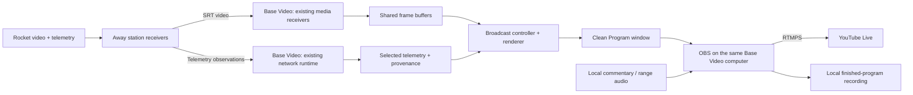
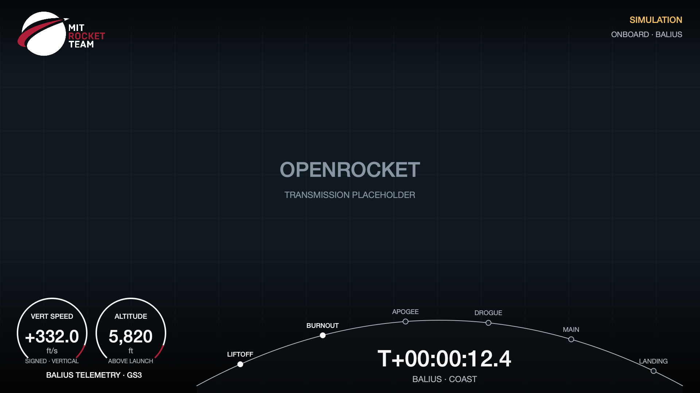

# Base Station Video → YouTube broadcast implementation plan

Date: 2026-11-01, America/New_York\
Status: software implemented and locally installed; see BROADCAST_VERIFICATION.md for the authoritative tested scope and remaining OBS/equipment/account gates\
Consistency reviews: 2026-11-01, including the Camera + Arc HUD and script review; resolutions recorded in section 22\
Repository baseline inspected: `978b618d69b8bfc8a66b058b270bed3ead43af13`

## 1. Intended result and ownership

The **Base Station Video monitor computer is the broadcast origin and the only computer sending the finished program to YouTube**. It receives the existing rocket video and telemetry feeds, assembles a SpaceX-inspired presentation with MIT Rocket Team branding, and provides production controls to the Base Video operator.

The accepted first implementation uses **OBS on that same Base Video computer** for the final audio mix, local program recording, encoding and YouTube upload. The telemetry application owns the visuals and data selection; OBS owns the internet streaming connection. No second broadcast computer, Base Telemetry application, or cloud compositor is required.

The public program is a dedicated clean output window. The normal Base Video wall remains the operator's working view, with station thumbnails, network information and source controls. Operator dialogs and hardware controls never form part of the program image.

This document records the accepted design and its qualification gates. The implementation and operator workflow are described in [BROADCAST_OPERATOR_GUIDE.md](BROADCAST_OPERATOR_GUIDE.md). The original one-frame sketch remains a design example; production uses the broadcast modules in src/rocket_gnc_monitor. The user authorized implementation and GitHub milestone pushes on 2026-11-03, stopping before the real YouTube test.

### Confirmed requirements

- Originate the YouTube stream from Base Station / Video.
- Use the existing rocket video downlinks and ground-station telemetry.
- Present large video, a mission clock, flight information and a restrained SpaceX-inspired layout.
- Support a selected telemetry receiver and the existing Best connection policy.
- Use Imperial by default, with OpenRocket's definitions; units affect display only.
- Preserve normal monitoring, telemetry collection, recordings and control behavior.

### Proposed first-release defaults

| Decision | Proposed default |
| --- | --- |
| Program canvas | 1920 × 1080, 16:9, SDR |
| Program cadence | 30 frames/second |
| Selected layout | Camera + Arc HUD: full-screen camera, MIT Rocket Team logo, two lower-left arc readouts, curved event rail and lower-center mission clock |
| Graphics | MIT Rocket Team identity, dark translucent panels, white text, restrained accent color |
| Telemetry source | Best connection after explicitly joining a mission; manual GS1–GS4 override |
| Camera selection | Manual in v1; automatic loss notices/slate are included, automatic alternate-camera selection is deferred |
| Telemetry display units | Follow the app's saved preference, initially Imperial |
| Broadcast buffer | Start calibration at 500 ms; accept it only if the path-delay/jitter test in section 10 passes |
| Transmission | OBS on the Base Video computer → YouTube over RTMPS |
| Commentary | A local microphone/audio interface selected in OBS |
| Recording | Finished program in OBS, with the existing application recordings retained independently |
| Startup | App Program output stopped; no automatic mission rejoin or request to start OBS. Independently running OBS is not stopped by the app |

## 2. Existing capabilities and actual gaps

The implementation must begin from the current code. Some older overview documentation still describes remote transport as pending; the transport and source-selection implementations below are the relevant baseline.

| Area | Existing behavior | Work required for broadcasting |
| --- | --- | --- |
| Base Video workspace | Owns the local Digital input, remote video wall and its network bridge | Add Broadcast controls and the clean program window to this owner |
| Network video | H.264 over leased SRT sessions, with source identity and media epochs | Share decoded frames with a broadcast consumer without duplicating transports |
| Camera resolution | Local capture and decoder output use `WIDTH, HEIGHT = 960, 540` | Preserve compatibility first; add negotiated higher resolutions later |
| Renditions | Preview: 320×180 at up to 10 fps; main: 960×540 at up to 30 fps, 3 Mbps target | Request main quality for program/inset feeds; maintain inexpensive thumbnails |
| Video wall refresh | `VideoWallNetwork` refreshes every 100 ms and consumes the latest queued frame | Expose the decoder frame path before this coalescing; copying the wall alone cannot deliver genuine 30 fps |
| Remote telemetry | Network bridge already receives and archives accepted observations | Expose a read-only broadcast feed in Base Video |
| Best connection | UI/default policy is currently gated to Base Telemetry | Extend eligibility to Base Video's broadcast controls using the same selector logic |
| Attitude | Explicit validated orientation, plus a separate received-packet simulation illustration | Reuse provenance and validation; never interpret gyro integrals as Euler attitude |
| Units | `DisplayUnits` supports Imperial/Metric presentation | Reuse it for all broadcast values and labels |
| Audio | Current capture and station video encoding use `-an`; audio is not carried by this pipeline | Use local audio inputs in OBS; rocket audio would require a separate later transport feature |
| Timing | Video delivery exposes local receive/decode time, not qualified camera exposure time | Calibrate an initial presentation offset and expose synchronization limits |
| Remote camera recording | Ordinary SRT reception updates frames; it does not itself archive every remote camera as a local video file | Preserve existing recordings where they exist; record the finished program in OBS; isolated remote-camera recording is separate later work |
| Internet output | No YouTube program encoder or publisher | Integrate OBS as the first delivery backend |

Primary code references:

- [Station workspace](../src/rocket_gnc_monitor/station_workspace.py): `StationWindow`, `build_system_cards`, `show_frame`.
- [Network bridge](../src/rocket_gnc_monitor/network_bridge.py): `StationNetworkBridge`, `telemetry_peers`, `source_options`, `_default_source`, `_select_best_source`, `_accept_remote`.
- [Network video receiver](../src/rocket_gnc_monitor/network/media_receiver.py): `MediaReceiver`, `VideoWallNetwork`, promotion and media-epoch handling.
- [Network media](../src/rocket_gnc_monitor/network/media.py): renditions, shared encoders and leased sessions.
- [Video wall](../src/rocket_gnc_monitor/video_wall.py): feed presentation and manual source selection.
- [Capture/recording](../src/rocket_gnc_monitor/media.py), [display units](../src/rocket_gnc_monitor/display_units.py), [rocket pose](../src/rocket_gnc_monitor/rocket_pose.py), [observation adapter](../src/rocket_gnc_monitor/network/observation.py).

## 3. Architecture and process boundaries



One `BroadcastController` belongs to the existing Base Video `StationWindow`. It uses the existing `Controller`, `StationNetworkBridge`, `NetworkRuntime` and media receiver ownership. Opening Preview or Program does not create another node UUID, station identity, camera worker, telemetry transport or network publisher.

Base Telemetry continues to operate independently. Broadcast telemetry selection is made on Base Video; it does not secretly follow a dropdown in another process. Both applications use the same receiver-selection policy, but sharing a choice between applications would be an explicit future feature.

Broadcast processing has no path to serial writes, uplink commands, pointer tracking, station assignments or pyro actions. Closing the operator panel or Preview does not stop an enabled Program. Explicitly stopping Program releases its broadcast-only resources; closing another consumer releases only that consumer's resources. Existing video-wall subscriptions and recordings continue.

The first version transfers the finished image to OBS through its window-capture source. OBS supports capture of an individual macOS window through ScreenCaptureKit. Select the exact Program window and hide the cursor; do not capture the entire application, which would include other windows. [OBS macOS capture documentation](https://obsproject.com/kb/macos-screen-capture-source)

## 4. Scope by release

### First usable release

- Base Video Broadcast panel, Preview and Program windows.
- Mission branding, main camera, optional inset, two arc readouts, mission clock and curved event timeline.
- Direct selection of an eligible GS telemetry source or Best connection.
- Shared video receiver leases and a broadcast frame subscription.
- Read-only presentation, Imperial/Metric formatting and truthful source labels.
- Fixed-rate output, bounded delay buffers and configurable alignment offsets.
- Manual camera/scene cuts, automatic signal-loss notices/slates and manually selected alternate feeds.
- OBS profile/scene template, setup instructions, commentary and finished-program recording.
- Authenticated local OBS status/control integration inside Base Video (accepted v1 extension).
- Local rehearsal, network fault tests and an unlisted YouTube qualification run.

### Subsequent additions, after the first release is qualified

- Automatic camera fallback, with candidate warm-up and switching hysteresis.
- Higher-resolution camera capture and SRT main renditions.
- Capture timestamps, frame IDs and explicit clock mapping for more precise synchronization.
- A direct encoder backend if removing OBS becomes a requirement.
- Ground-track or trajectory graphics once their data source and datum are qualified.
- Rocket audio transport, if an actual audio source is available.
- Isolated recording of every received remote camera at Base, and instant replay during an ongoing live show.

Initial delivery does not require a new rocket protocol, telemetry fusion, new radio hardware, a new onboard attitude estimator, an internet connection from the rocket, or any automatic flight-control behavior.

Qualify the first release on the actual macOS Base Video computer. Keep the application modules portable, but treat Windows capture/OBS templates and native packaged tests as a separate qualification target; a passing Mac rehearsal does not establish Windows readiness.

V1 supports one active mission/source-mode session and one on-air telemetry vehicle at a time. A replay scene is available when the application is already in its existing REPLAY session; it is not an independent replay player layered over an active LIVE session. Changing application source mode follows the existing transport/recording lifecycle. Keep live reception uninterrupted by remaining in LIVE; simultaneous live reception and editorial instant replay require later independent playback ownership.

## 5. Audience layout specification

### Selected layout: Camera + Arc HUD

**Choose Camera + Arc HUD for the first release.** This adopts the user's reference frame: two open circular readouts at lower left, a broad curved event rail along the bottom, and the mission clock centered beneath the curve. The background is the selected camera feed. Use the actual MIT Rocket Team logo at upper left. The earlier three-column strip and top-right clock are superseded.



This frame was assembled by the [executable composition sketch](examples/broadcast_frame_sketch.py), using an OpenRocket-style transmission placeholder and illustrative telemetry. A supplied camera frame replaces that placeholder. The earlier [generated concept](assets/youtube-broadcast-frame-v1.png) remains a historical reference only.

The team mark is the exact [transparent PNG downloaded from the user's supplied web URL](assets/mit-rocket-team-logo-web.png). It retains its original white/red colors, lettering, proportions and transparency. The [source URL, retrieval date and checksum](assets/mit-rocket-team-logo-source.md) are recorded alongside it. This replaces the earlier locally sourced SVG. Cache and package this asset; rendering never depends on an internet download.

Keep the central camera view open. Use thin white arcs, restrained team-red end accents and translucent black gradients behind the graphics. There is no opaque full-width telemetry card. The reference's Earth and orbital paths are not part of this layout; the curved bottom line represents the mission's event sequence, not a geographic trajectory.

### Canvas and positioning

All coordinates below are pixels in a fixed 1920×1080 composition raster, not macOS window points. Preview and Program windows can display that raster at a separately chosen scale. OBS capture dimensions must be qualified as described in section 12. Letterbox mismatched video aspect ratios rather than stretching them. Cropping is an explicit per-camera option with a visible Preview indication.

| Element | Placement and behavior |
| --- | --- |
| Main video | Full canvas underneath overlays; preserve its original aspect ratio |
| Team logo | x=48, y=32, width=240, height≈121; preserve the downloaded 1500×758 image's aspect ratio |
| Mode/source labels | Top right, ending at x=1872; LIVE SOURCE, SIMULATION or REPLAY at y=36, camera caption at y=78 |
| Vertical-speed readout | Open 190×190 arc at x=48, y=820; label VERT SPEED, signed value, ft/s or m/s |
| Altitude readout | Open 190×190 arc at x=264, y=820; ALTITUDE, value, ft or m, plus datum beneath |
| Telemetry source/status | x=48, y=1014, width=420, height=32; qualified vehicle/GS or concise stale/unavailable notice |
| Event timeline | Cubic curve from (540,1060) through control points (980,820) and (1432,820) to (1872,1060); completed/hollow markers with labels above |
| Mission clock | x=820, y=941, width=800, height=85; centered under the curve, tabular digits, approximately 62 px |
| Mission and flight state | x=820, y=1026, width=800, height=30; e.g. BALIUS · COAST, or an explicit unavailable/last-known state |
| Optional inset | Off in the selected default scene; if deliberately enabled, x=1424, y=148, width=448, height=252, for a second camera or valid orientation view |
| Loss notice | Small persistent label on an affected retained image; a clear centered message on a fallback slate |
| Contrast scrims | Top y=0–200 and bottom y=680–1080; transparent-to-black gradients keep labels readable over bright footage |

Keep important text at least 48 px from the left/right edges and 24 px from the bottom. Use font sizes that remain readable in a 720p player. Use tabular numerals to prevent changing numbers from shifting labels. Keep long mission names bounded to two lines or an operator-chosen short title.

The selected preset has fixed text rectangles. Use an operator-chosen short mission title or elide decorative titles after validating them in Preview; never truncate a numeric magnitude or source-mode label. Important status text must retain the unavailable/stale/approximate qualifier even when shortened. Fit readout numbers down to the qualified minimum font size, then show `—` with an operator explanation if they still cannot fit. Use the actual packaged font metrics in the 720p readability test. Decorative curve ends may extend beyond the text-safe boundary; text must stay inside it.

The two gauge arcs are fixed graphical frames, not percentage meters. Their red ends are brand accents, not over-speed/altitude thresholds. Do not introduce a maximum, warning range, needle or moving fill without a separately specified physical scale. The event curve uses categorical order with even visual spacing; its geometry does not predict event times.

### Telemetry readouts

The default shows **VERTICAL SPEED** and **ALTITUDE** in the two lower-left arcs. **FLIGHT STATE** is the text below T+ beside the mission name. There is no MAX ALTITUDE readout in this selected preset; adding another metric is a later layout decision. T+ uses `T+HH:MM:SS.s` or T− for countdown and remains aligned to the represented camera time.

- Label the altitude datum: above launch, MSL or ellipsoid, according to the source contract. Do not relabel an unknown datum as AGL.
- The current scalar velocity is not automatically total speed. Use “Vertical speed” only for a source with established vertical-velocity semantics; otherwise use an appropriately qualified label or suppress it.
- Render unavailable numeric values as `—`, not zero.
- Retain minus signs for descent and consistent precision: proposed altitude nearest foot/metre, vertical speed one decimal, elapsed time to tenths or whole seconds based on scene.
- Use the application's `DisplayUnits` conversion functions. Do not duplicate conversion constants in drawing code.
- An on-air units change updates values, axis labels, captions and cached layout together at a frame boundary.
- Any numerical smoothing is cosmetic and does not change raw data, event detection, recordings or control calculations. The first version can hold the most recent eligible value instead of inventing intermediate values.

### Optional orientation inset

The selected default keeps the inset off to preserve the reference's open camera view. Enabling an orientation/second-camera inset remains an explicit Preview/Take choice; it must not appear automatically when telemetry changes. The single-frame script below covers the default layout, so inset composition is a later step in M1, using the already specified rectangle.

Reuse the validated +Z-nose body-to-ENU pose path. A physical LIVE source without orientation remains “Orientation unavailable.” Independent body gyro integrals do not rotate the model. A packet-associated OpenRocket pose is marked as simulation and follows its selected receiver's actual accepted packet history.

Preserve unknown motor/chute states. Flame, parachute and ignition graphics require the corresponding validated evidence. Do not equate a commanded pyro action with physical deployment. If no useful pose is available, the operator can choose a second camera or remove the inset.

## 6. Scenes and event graphics

| Scene | Main image | Overlay emphasis | Entry |
| --- | --- | --- | --- |
| Prelaunch | Local pad/ground camera or selected onboard feed | Mission title, scheduled T−, concise readiness caption | Operator |
| Flight | Selected onboard feed | Altitude, vertical speed, state and T+ | Operator; event-based transition may be added later |
| Recovery | Available onboard/ground feed | Descent information and evidenced recovery state | Operator |
| Signal lost | Branded slate by default; healthy alternate only after an operator Take in v1 | Which source is unavailable and whether telemetry continues | Automatic loss override; manual alternate-camera cut |
| Replay | Selected recording in the current REPLAY session | Persistent REPLAY label and playback clock | Operator, after explicitly entering REPLAY |
| End card | Team/mission card | Mission complete caption entered or confirmed by operator | Operator |

Editorial scene/camera/inset changes are staged in Preview and require **Take**. They apply on the next output frame after readiness succeeds. Automatic loss/identity notices and slates are presentation overrides, so they do not wait for Take. Telemetry selection, Best connection updates, units and clock actions have the distinct semantics below; they are not camera cuts. The first version uses hard cuts; an optional short dissolve can follow once dual-frame composition meets the performance budget.

The timeline lists mission-configured events such as launch, burnout, apogee, recovery deployment and landing. Each event stores its evidence type: received event/state, qualified simulation event, or operator annotation. Only supported events light up. Forecast times are shown as planned, not completed. For multiple vehicles, events remain scoped to their own vehicle.

Use stable event IDs and a mission/vehicle event ledger, separate from the latest sample. The six markers in the sketch are example configuration, not a universal rocket sequence; production supports up to six short, non-overlapping labels in this preset. Include only events configured for that vehicle, with LIFTOFF meaning liftoff rather than ignition. An accepted observation from the selected display path, a qualified playback event or an explicit operator annotation can add evidence. Deduplicate equivalent events across GS changes while preserving their provenance; switching receivers must not erase a previously evidenced milestone. Never fill in missed events merely because a later state arrived. Contradictory timing/evidence needs a logged correction or an uncertain marker, not a guessed completion. Replay seeks rebuild visible completion at the playhead; a new mission/run clears the old ledger.

Do not use a single universal integer-to-flight-state mapping. Preserve the received state schema and reuse the existing state adapter. Legacy Zephyrus states, provisional Balius states and simulation state provenance must not be conflated.

## 7. Operator workflow on Base Video

Add a **Broadcast…** button to the Base Video toolbar. It opens an operator panel without replacing the existing video wall.

The panel contains:

| Control group | Controls |
| --- | --- |
| Mission | Display title and team branding; read-only joined mission, configured vehicle family and qualified on-air vehicle identity |
| Preview | Scene, main camera, inset camera/orientation/off, Preview canvas |
| Program | Current scene/source summary, Take, Open Program window, Output ready/stopped status |
| Telemetry | Best connection or eligible GS source; resolved GS; sample age; unavailable reason |
| Clock | Planned launch time with timezone, Hold/Resume countdown, Set launch now, enter/correct T0 |
| Timing | Broadcast delay, per-feed alignment offsets, calibration status |
| Appearance | Follow display units, optional captions, title-safe preview guide |
| Delivery | OBS setup/profile instructions, encoder preset, recording destination guidance |
| Health | Camera age/fps, selected rendition, compositor frame time, buffer use, dropped presentation frames |

Video-wall double-clicks keep their existing monitoring behavior. Once broadcasting starts, they do not silently change the on-air shot. Broadcast camera changes are staged in Preview and committed by Take. An optional “Use this monitor source in Preview” action can reduce operator clicks without linking Program to exploratory browsing. Both windows remain subject to the receiver capacity rules in section 9.

| Change | When it affects Program |
| --- | --- |
| Scene, main/inset camera, captions or branding | Explicit Take, at the next output boundary after all required inputs are ready |
| Manual telemetry policy/receiver selection | Next output boundary; select that receiver's buffered sample at Program time |
| Best connection's resolved receiver | Once-per-second policy evaluation, then next output boundary; no camera cut |
| Display units | Next output boundary, as one atomic values/labels update |
| T0/countdown action | Logged clock-state revision; displayed time is evaluated at Program time |
| Delay or calibration change | Stage the setting; rebuffer on a slate and recalibrate audio before taking content again |
| Loss/conflict/mode label | Automatic immediate output override; no operator Take required |

Preview uses the same delayed presentation timeline as Program for the proposed shot. The regular monitoring wall remains immediate. This avoids marking a candidate ready merely because its current frame exists while the frame needed for Program time is missing.

Only Base / Video exposes these controls. Away Video keeps its capture/transmit role; Base Telemetry keeps its instruments and command ownership. Keyboard shortcuts apply only when the Broadcast panel has focus and must not collide with existing serial/pointer shortcuts.

In the first release, the operator starts/stops internet streaming explicitly in OBS or through the authenticated local OBS panel. Base Video reports **Program output ready**, not “YouTube live.” Opening a local window, seeing video in OBS, OBS sending data, and YouTube publicly serving the event are distinct states.

Opening Program initially shows the built-in slate. The first content scene also requires a ready Preview/Take. Readiness applies only to inputs required by that scene: an end card or camera-free slate must remain available when every camera is down. A missing optional telemetry field produces its defined unavailable presentation rather than preventing an otherwise valid camera shot.

## 8. Telemetry receiver selection

Extend the existing network bridge rather than implementing a separate ranking algorithm. Make `source_options` and the relevant default selection available for Base Video broadcasting, while preserving Base Telemetry behavior.

The broadcast selector exposes Best connection and eligible remote GS1–GS4 entries. It must filter out the bridge's existing Local telemetry board entry; selecting that entry cannot be a fallback for this read-only Base Video feature. Reuse/extract the ranking policy, not a second serial/controller owner.

Eligibility requires the explicitly joined mission, matching vehicle/source mode, a telemetry-capable publisher, usable synchronized protocol state, and no identity conflict. Here, network `synchronized` refers to the application's peer/event synchronization state; it is not a claim that independent host clocks are synchronized for audiovisual timing.

The existing bridge filters the vehicle family, then scores the minimum age among a peer's latest observations. Broadcast must additionally partition observations by the qualified on-air vehicle ID before computing that score or selecting history. A fresh booster packet cannot make a receiver eligible for a sustainer overlay. Keep the existing ranking/tie-break rule after this attribution filter, and preserve Base Telemetry's established behavior. An unknown on-air identity cannot silently acquire a specific vehicle's values.

Best connection evaluates once per second using the established rule:

1. Exclude offline/conflicting/ineligible receivers and telemetry older than the configured freshness limit.
2. Compare the existing rocket packet-age score. Ages up to 60 ms are tied at full quality; older samples rank lower.
3. Break equal rocket scores using lower LTU-XR application round-trip time.
4. Keep the current receiver on an exact tie.
5. If no receiver qualifies, report telemetry unavailable; do not fall back to a local hardware board.

Keep the distinction between application RTT and actual radio signal strength. No RSSI-based “best signal” claim is implied by this policy.

A manual GS choice stays fixed during a dropout. On receiver changes, select that receiver's own history; do not merge, average or interpolate across receiver histories. Record the switch time and the observation that became eligible. Switching receivers does not reset T0, change the camera, alter units or enable commands.

Separate desired policy, resolved current receiver and last presented observation. If Best connection resolves to no eligible receiver, it stops supplying fresh telemetry. The compositor may retain the last presented values only under the explicit stale/age policy in section 13; they remain labelled last-known from their former GS and are never treated as a fallback receiver. Choosing a receiver with no buffered sample at Program time yields unavailable data until its buffer is ready, not that receiver's newer current sample.

The current observation adapter already keeps remote display data separate from local `Controller.latest/history`. Preserve that separation. Base Video must receive telemetry directly from eligible publishers; it must not depend on the Base Telemetry window being open.

### Canonical observation to broadcast fields

Retain canonical observation metadata at the accepted network-event boundary. The legacy `Sample` projection alone is insufficient: it currently does not retain every canonical datum/timing field. Join the canonical values, observation ID and original local event arrival once, then form the read-only broadcast record. Do not reconstruct provenance from rounded UI text or GUI polling time.

| Canonical input | Broadcast mapping and availability |
| --- | --- |
| `values.baro_altitude.value_m` and `.datum` | Use finite metres; map `agl_launch` → `above_launch`, `msl` → `msl`, `wgs84_ellipsoid` → `ellipsoid`; `unknown` stays unknown and the selected preset suppresses that altitude value |
| `values.position.alt_m` and `.alt_datum` | A separately qualified GPS altitude source only; never silently replace barometric altitude or invent its datum |
| `values.velocity_enu_m_s` | Use the signed up component only under a validated, supported ENU schema. The inspected publisher currently emits null |
| `values.native.velocity` under `rocket-telemetry.sample/1` | Units are m/s, but the generic scalar does not establish vertical semantics. Leave the vertical readout unavailable unless the specific decoder/mission contract qualifies it |
| `values.state`, `values.flight_status`, `values.simulation_display` | Keep their schema, evidence and packet association; only the appropriate state/pose/event adapter may produce audience labels |
| `vehicle.id`, `receiver`, `observation_id`, `timing`, event `received_local_mono` | Preserve vehicle, receiver/boot/connection identity and clock provenance through buffering and source changes |

The current physical publisher defaults barometric datum to unknown and ENU velocity to null. Therefore a healthy packet stream can legitimately leave one or both arc readouts unavailable. M0 must record which fields the actual sources can qualify and what adapter/configuration work is needed; the illustrative JSON is not evidence that real sources already provide those semantics. Do not change raw data or assume zeroing/launch location established a datum. A separate datum/semantics configuration must have an explicit documented basis before it enables a value.

## 9. Video selection and resource sharing

Use a stable source key containing mission ID, vehicle ID, source mode, publisher node/boot IDs, station, stream ID, media epoch and rendition. A station label or stream name alone is insufficient identity.

The existing video wall promotes a requested stream to main quality only after it decodes. Preserve that behavior, but introduce a shared consumer model so Preview, Program and the monitor wall can request different feeds without taking sessions away from one another.

Suggested consumer names are `monitor-main:<channel>`, `broadcast-program`, `broadcast-inset` and `broadcast-preview`. A single matching receiver serves multiple consumers. Release a lease only when no consumer needs it. Promotion must not allocate a second identical main receiver just because the broadcast window opened.

Budget the union of existing wall receivers and broadcast consumers. The wall already has two Balius or three Iris main channels; a global limit of three main sessions would leave no room for an Iris camera cut. Broadcast can add at most one Program source, one inset and one transient candidate beyond the wall's existing distinct sources. Sources already shared with the wall add no receiver. Thus the worst initial union is six distinct main sources for Iris, before separately counting any temporary preview/main overlap. This is an upper demand bound, not a promise that all stations or computers can admit it.

Admission must satisfy measured local decode/bandwidth limits, the configured buffer budget, and each publisher's session limits. Ordinary publishers currently allow at most four active sessions in total and two of each rendition across their channels; simulation publishers can have different per-stream limits. Thus three Iris main feeds cannot all be assumed available from one ordinary publisher; M0 must check their actual distribution and capacity. Other viewers also consume publisher capacity. Preserve active Program and current wall feeds; do not evict them to admit a candidate. If capacity is insufficient, keep the new request pending with a specific reason and keep Take disabled. A thumbnail is a viewing aid, not evidence of main-quality readiness.

Qualify and reserve capacity for at least one candidate promotion in the intended layout before starting the show. If that cannot be achieved, reduce the planned inset/extra-source load before Program starts. Local admission can preserve headroom for a candidate, but cannot guarantee remote capacity against unrelated viewers; every request still handles a publisher refusal. A new monitor-wall request also goes through admission and may remain pending; independence from Program does not imply unlimited resources. In v1, Preview may prime at most one camera identity that lacks retained history; change two new sources through successive Takes, or use identities already buffered. Take itself always requires every selected camera to be ready. Reusing/swapping two ready feeds requires no new promotion slot.

Budget ground-station traffic separately from the YouTube upload. At the current target rates, each main SRT rendition contributes roughly 3 Mbps and each preview roughly 0.25 Mbps before transport overhead. Count actual simultaneous receiver sessions and temporary promotions; sharing a decoder locally avoids an additional session, whereas opening another independent viewer may add network traffic. Measure the complete wall + Program + inset + OBS workload, not just the internet encoder bitrate.

Manual switching sequence:

1. Select the candidate in Preview.
2. Acquire/reuse its main rendition and validate identity/epoch.
3. Prime the candidate's own bounded delay buffer until the frame required at Program time exists, and verify age/identity; only then mark Preview ready.
4. On Take, switch Program atomically at a render boundary.
5. Release superseded broadcast-only leases after the switch; preserve wall/inset consumers.

For Iris, sustainers and boosters remain separately identified. Telemetry for one vehicle must not appear as the telemetry of another camera's vehicle. If identity is missing or ambiguous, show the mismatch/unavailable state in Preview and suppress misleading on-air values. Do not infer attribution from the words “Analog” or “Digital.”

The configured vehicle family (`balius` or `iris`) is not an observation's vehicle identity. Current physical Iris telemetry commonly reports `vehicle.id = unknown`; those samples cannot populate a claimed Sustainer or Booster overlay. V1 may show the configured camera view with telemetry unavailable. A known camera mapping can be labelled as operator-assigned, but it does not establish telemetry attribution. Cross-vehicle simultaneous overlays and scene-dependent vehicle selection are deferred.

A local ground camera has no remote node/mission metadata. Give its broadcast adapter a separate local source identity and capture epoch, and explicitly associate it with the current production scope as a ground view. Do not invent remote publisher fields or measured vehicle identity. In a simulation/replay session, that scope's badge remains prominent and the real local view must be explicitly labelled Ground camera; it is not a simulated/onboard rocket view.

## 10. Time, delay and synchronization

### Clock domains

Maintain these separately: local host monotonic receive/decode time, source device uptime, any available capture/acquisition time, simulation/replay time, and wall-clock UTC. Never subtract independent hosts' monotonic clocks.

`Sample.received` can represent an age-adjusted display timestamp for remote data. Preserve the network event's actual `received_local_mono` value before the bridge's polling delay, rather than using either `Sample.received` or the later GUI drain time as arrival time. Snapshot/bootstrap reads need an explicit local fetch time and historical/unknown timing provenance; fetching an old observation does not make it newly acquired. Deduplicate by observation identity. Preserve the lower-bound source-age estimate and uncertainty; do not relabel it as a camera-aligned measurement time.

### Initial alignment model

For calibrated live paths, use the following local monotonic-clock quantities:

| Symbol | Meaning |
| --- | --- |
| `R` | Current local output/render time |
| `D_i` | Estimated nonnegative end-to-end delay of feed i, from event/acquisition to local arrival |
| `J_i` | Qualified extra delay/jitter allowance for that feed |
| `G` | Render/scheduling guard, initially one 30 fps interval |
| `B` | Common event-to-composition delay, excluding subsequent OBS/YouTube delay |
| `T = R - B` | The common event time represented by the composed frame |

For each received item, estimate `event_time = local_arrival_time - D_i`. At output time `R`, choose the newest eligible item with `event_time <= T`; never fill a missing historical item with a newer one. With variable delay this is an estimate, not a qualified exposure/acquisition timestamp.

The calibrated configuration is admissible only if `B >= max(D_i + J_i) + G` for the active synchronized feeds. Plan retained history for each feed of at least `max(0, B - D_i) + J_i + G`, plus measured scheduling/ownership overhead, and account for the actual frame bytes. The 500 ms default is only a starting calibration value: a camera path taking 800 ms cannot be aligned by adding a nominal 500 ms event-to-composition delay. Raise B within the validated memory/latency limits, or report synchronization unavailable.

A shared receive-time buffer by itself does not remove unequal path delays. Before calibration, the output can operate in explicitly uncalibrated receive-time mode, using a common local-arrival timeline and showing `SYNC UNCALIBRATED` to the operator. Do not claim event-time alignment or the controlled-fixture accuracy for that mode. Missing timing provenance remains unknown, rather than becoming a fabricated zero-delay measurement.

Calibrate using a visible timing slate and a corresponding telemetry marker generated from a known common clock. Check audio with a visible clap/tone. Save the measured offset, method, date and residual error for each feed. Recheck after changes to capture hardware, codec, rendition or network path. Operator adjustments affect broadcast presentation only; do not reuse the mission's existing `video_offset` as an unrelated global setting.

Store effective path delays and their calibration version. If a calibration interface accepts signed relative offsets, normalize them to a common reference and recalculate B and memory requirements; never interpret a negative offset as permission to fetch a future frame. Relative alignment alone does not establish absolute event-to-picture delay for T0 or range audio; retain that uncertainty until a common-clock reference is measured. Reject unsupported combinations rather than silently clamping them. Changing B or a path delay invalidates that timing generation: stage the change, switch to a slate, rebuffer, verify the corresponding OBS audio compensation, then explicitly Take the ready scene. This prevents a mid-shot clock jump or hidden audio desynchronization.

Qualify one fixed timing configuration for every GS that Best connection is expected to use, and choose B to cover that set. A source switch can reuse a previously validated per-feed delay without changing the timing generation. Ranking still chooses the best eligible receiver by section 8; presentation readiness is a separate gate. If the winning receiver has no compatible calibration or history at T, report the selected GS with telemetry unavailable and an operator reason. Do not secretly choose a worse receiver, substitute newer values or change B automatically. A camera candidate whose delay does not fit the active configuration remains pending until a deliberate timing change and rebuffering procedure completes.

### Staleness and source transitions

Store both freshness at program time and current source health. A deliberately delayed historical sample can be valid for its corresponding delayed picture, but a new loss alert must still identify that the live source is unavailable. Never let a countdown or animation imply new packets arrived.

Separate **output-time decisions** from **event-time media**. A camera Take or resolved telemetry change commits at the next output boundary R; its data still comes from each selected feed's history at T. Selection itself is not held back by another B seconds. Log both the output time and represented program time. If the newly selected receiver has no eligible sample at T, show unavailable; never put its current numbers over the delayed picture. Keep pre-switch history long enough for retained snapshots and do not interpolate across receivers.

A mission, vehicle or source-mode change invalidates the entire incompatible program scope and requires a ready Preview/Take. A single camera media-epoch change invalidates that camera's buffer only: apply its loss/slate policy without resetting T0, healthy telemetry or another camera. A telemetry receiver reboot invalidates that receiver's history, not the entire broadcast. Reappearance under the same logical camera but a new epoch requires rebuffering and identity validation.

### Mission clock

- Planned countdown uses an explicit timezone-aware scheduled launch time, mapped to a local monotonic anchor while running.
- Hold freezes the displayed countdown. Resume/revise is an explicit production action.
- Reaching the planned zero without qualified actual liftoff enters AWAITING LAUNCH; it must not start a positive T+ or complete LIFTOFF automatically. The clock has explicit countdown, hold, awaiting-launch, actual-launch/elapsed and unavailable states.
- T+ begins from a qualified launch timestamp or the operator's Set launch now action. A state packet's arrival time is not automatically the actual ignition/liftoff time.
- Evaluate the on-air clock as `T - T0`, not `R - T0`, so it represents the delayed picture. A Set launch now action anchors an actual event observed now at R; a separate Mark launch on Program action, if provided, anchors the displayed frame at T. Do not use one ambiguous button for both. An early launch indication can leave the delayed picture briefly at T− until it reaches T0.
- Store clock basis and uncertainty. If only reception time is known, identify the operator/reception basis rather than asserting exact launch timing.
- T0 survives GS changes and short telemetry loss. Corrections are deliberate and logged.
- Replay uses the existing replay session clock, mapped to its buffered content; simulation uses a qualified mission-time mapping when supplied. Device uptime or a network peer's simulation label alone does not supply that mapping. If no mapping exists, the clock remains unavailable until the operator supplies an explicitly labelled anchor.
- Paused replay/simulation retains its picture and clock with a PAUSED label; lack of advancing content is not a camera-loss event while pause is explicitly known. Transport disconnection is still reported. Seek/run changes create a new playback epoch and clear incompatible buffers/events; changing playback speed updates the clock mapping without changing output cadence.
- Highlight a recorded/received timeline event only when its qualified event time is at or before T. Manual “event now” annotations use the same observed-now versus displayed-frame distinction as T0. A slate may announce a current loss immediately, but future flight milestones must not lead the delayed video.
- Scheduled times must carry a UTC offset/timezone; local times around daylight-saving transitions must not be interpreted ambiguously.

For playback, evaluate the content/mission clock through its explicit mapping at the selected presentation point; do not apply the live wall-clock subtraction blindly to a paused or accelerated session. Known content-time timestamps take precedence over estimated arrival-minus-delay mapping within that playback scope. The output timer remains 30 Hz. In uncalibrated live mode, any operator clock is explicitly approximate; receive-time buffering alone cannot establish an accurate event T+.

## 11. Proposed internal contracts

These are application-internal interfaces, not new rocket wire protocols or externally published station schemas.

| Object | Minimum fields and invariants |
| --- | --- |
| `BroadcastScope` | Mission ID, configured vehicle family, qualified on-air vehicle ID or unknown, source mode, run/session epoch; local ground-view association is separate from measured attribution |
| `BroadcastFrame` | Remote source key or explicit local-camera key/capture epoch, width/height/stride/pixel format, immutable pixel ownership, local decode time, optional capture time and uncertainty, frame ID if available |
| `BroadcastTelemetry` | Observation ID, receiver node/boot/connection, local arrival time, source-age estimate, measurement time/datum if known, native values, field availability and provenance |
| `BroadcastSelection` | Desired telemetry policy, resolved receiver or none, last-presented source identity, main/inset keys, scene, effective output time R, program time T and reason |
| `BroadcastClock` | Explicit countdown/hold/awaiting-launch/elapsed/unavailable state, distinct actual T0 and planned launch anchors, held value, correction history, time basis and uncertainty |
| `BroadcastSnapshot` | Selected frames and observation for one program time T, output time R, timing generation/calibration status, units, scene, configured events and evidence ledger revision, clock state/basis, presentation freshness, current source health and branding |
| `BroadcastHealth` | Buffer occupancy, missed frames, source readiness, render duration, output status, separate delivery-status knowledge |

Adapters validate inputs once; the renderer consumes a complete snapshot without reading mutable controller fields halfway through a frame. It draws a consistent units/source/scene combination. A snapshot carries references to immutable frame data instead of copying all images per repaint.

Define explicit reasons for missing data, including `no_sample`, `stale`, `wrong_scope`, `identity_conflict`, `unavailable_field`, `unknown_datum`, `unsupported_orientation`, `waiting_for_main` and `buffer_not_ready`. Convert these into concise audience text and more detailed operator explanations.

## 12. Rendering, threading and performance

The initial renderer uses Qt's existing painting infrastructure and the fixed composition raster. Separate drawing from window management so the same renderer can produce Preview, Program and verification images. Widgets and `QPixmap` stay on the GUI thread; worker threads pass immutable bytes or correctly owned `QImage` data.

Expose decoded frames before `VideoWallNetwork`'s 100 ms refresh. Its current queue drains to the latest frame for monitoring; attaching the broadcast only to `VideoWall.update_remote_frame` would cap source updates near 10 fps. Preserve the wall's efficient coalescing while giving Program an independently paced subscription. Do not have two consumers race to drain one queue.

Use monotonic render deadlines at 30 Hz. Render the newest eligible snapshot and skip an expired presentation deadline instead of building a backlog. Composition must not wait on network, disk, capture or archive operations. Because painting shares the GUI thread, measure its effect on GUI polling as well as render duration; separate worker reception/archival must continue independently. On an overrun, skip output slots rather than repeatedly trying to catch up. Show measured source fps separately from output fps; repeating a 10 fps source on a 30 fps canvas is not 30 unique camera frames.

Frame-subscription callbacks must return promptly and insert only into a bounded broadcast buffer. Drop history that is no longer needed before admitting another copy; if the byte/pin limit still cannot be met, drop the broadcast copy, count the overrun and apply the gap policy. Never block the decoder or steal the wall's queue to preserve broadcast history. Admission for Preview still fails before it can evict active Program resources. The production timer computes its next deadline using the time after composition finishes, anchored to the original 30 Hz schedule.

Proposed initial budgets, to be measured on the actual Base Video computer:

- 33.3 ms frame interval, with compositor work targeted below 20 ms at the 95th percentile.
- No additional network receiver for an already-requested identical source/rendition.
- Broadcast frame buffers capped at 256 MiB initially, with a visible capacity estimate before changing delay/resolution.
- Program, inset and the one pending candidate retain the history needed for a ready Take. Candidate history counts against the same 256 MiB cap; it is not a separate unbounded allocation. Thumbnails retain their existing small latest-frame storage. Pin current snapshot frames only as long as consumers need them, and include pinned references/copies in the capacity estimate.
- One-hour rehearsal with no growing queue/memory trend and no loss of the existing archival/monitoring behavior.

Memory matters: RGB24 960×540 video is about 44.5 MiB per second at 30 fps per stream. Two streams buffered for two seconds consume about 178 MiB before overhead. At 1920×1080 the same buffers require about 712 MiB. Reject unsupported buffer/resolution combinations or qualify a more efficient storage path; do not silently exceed the budget.

Render into an actual 1920×1080 pixel raster independent of macOS window points. A 960×540-point Program content area on a 2× display can expose that raster at 1920×1080 capture pixels; a 1920×1080-point window would instead expose roughly 3840×2160 and may not fit the screen. Measure the captured content rectangle, including cropping and display scale, rather than assuming either size. Lock the qualified Program content geometry; resize the operator Preview freely. If the available capture path cannot supply the required pixel area, qualify the 720p preset or a different output path instead of claiming native 1080p detail.

Verify that Program keeps updating when the operator uses other apps. Do not assume minimized/hidden windows keep producing frames. Prevent accidental Program minimization while it is enabled, and revalidate capture size after display/scale changes. Keep the entire OBS camera-capture requirement separate from raster generation: rendering the raster alone does not prove OBS is receiving it.

## 13. Signal loss, conflicts and fallback

The following thresholds are proposed broadcast presentation defaults; they do not modify station transport watchdogs or mission telemetry freshness settings. Keep these measurements distinct:

- **Current camera health:** elapsed host time since the most recent decoded frame arrived, plus explicit transport/identity state and trustworthy source-health metadata where available. Do not add B to this age. Repeated decoded pictures prove transport activity, not new camera exposure; without acquisition IDs/times a frozen upstream camera may be undetectable. Do not infer a freeze from identical pixels in a static scene.
- **Current telemetry health:** the latest observation's reported age at arrival, when known, plus elapsed host time since that actual arrival. Unknown age remains unknown; an old snapshot is not a new measurement.
- **Presentation freshness:** age of the selected observation relative to T in its qualified time mapping. In uncalibrated receive-time mode, carry the reported source-age estimate plus elapsed time on that timeline, with its uncertainty visible to the operator. Do not add the intentional common buffer a second time.

Presentation freshness determines whether an on-air number can be shown as current for the picture. Current health can independently add an immediate source-loss notice, even while the buffer still contains historically valid content. If a source has recovered now but its history at T is missing, continue the waiting/slate indication until that history is ready. Explicitly paused playback is handled separately below.

| Condition | Program behavior | Operator behavior |
| --- | --- | --- |
| Brief current camera gap, under 0.5 s | Continue eligible buffered content; hold the last eligible frame if needed | Show arrival age and presentation age separately |
| Current camera gap of at least 0.5 s but under 2 s | Add VIDEO DELAYED; any held picture remains labelled | Amber source indicator |
| Current camera gap of at least 2 s | VIDEO SIGNAL LOST on the affected tile; branded slate for a lost main feed; alternate feed requires manual Take in v1 | Prominent source failure and candidate readiness |
| Explicit source unavailable/conflicting | Slate the affected image immediately; do not retain a potentially wrong-identity frame | Show identity/conflict reason |
| Missing history at T while current source is healthy | BUFFERING / SYNCHRONIZATION UNAVAILABLE; no newer-frame substitution | Show missing history or calibration reason |
| Telemetry presentation age exceeds mission freshness limit | Mark values stale with age; remove active-looking numeric interpolation and pose animation | Keep last-presented GS visible |
| Telemetry presentation age reaches max(5 s, mission freshness limit) | Replace numeric values with `—`; any retained state is explicitly last-known, with no active motor/chute animation | Show waiting for data |
| Current telemetry source unavailable or Best connection resolves to none | Add a telemetry-loss notice immediately; last-presented values follow the same age-to-unavailable limits | Distinguish desired policy, no resolved receiver and last-presented GS |
| Camera alive, telemetry lost | Continue camera and clock; show telemetry unavailable | Keep video controls available |
| Telemetry alive, camera lost | Continue qualified telemetry on the slate or manually selected alternate | Offer healthy camera candidates |
| Explicitly paused replay/simulation | Retain the paused frame, clock and historical values with PAUSED and mode labels | Report actual transport loss separately; do not infer pause from silence |
| Mission/vehicle/source mode changes | Clear incompatible content to a slate immediately; persistent SIMULATION/REPLAY label where applicable | Require a ready Preview/Take for the new scope |
| OBS/internet fails | Local Program and application data collection continue independently | The app reports measured OBS output/status when connected and unknown otherwise; the operator checks the YouTube return separately |
| Application output fails while OBS stays alive | Use a prepared OBS emergency slate manually in v1 | The current integration does not implement an automatic OBS emergency-scene heartbeat; use the independent OBS slate |

Loss overrides apply per tile. A failed inset does not blank the healthy main picture. A failed main feed does not remove healthy telemetry or an independently healthy inset. Slate generation does not require a camera receiver slot.

For the same still-selected logical camera, normal recovery may remove its loss override automatically after one second of continuous valid decoding, identity validation and a primed buffer at T. A new media epoch must be revalidated; it cannot reuse the old frames. If the operator has taken a different shot, recovery of the old camera cannot change Program. This is source recovery, not automatic alternate-camera selection.

Automatic alternate-camera selection is a follow-on feature. Proposed policy: require at least one second of continuous valid decoding and a primed delay buffer from the alternate; switch only after the active source meets the loss criterion; hold the new shot for at least five seconds unless it also fails. Do not automatically switch back just because the preferred source briefly reappears. Prefer a designated ground camera, then a same-vehicle alternate, then the slate. Never choose an unidentified or other-vehicle feed as if it were the same rocket. This later policy must obey the same receiver admission limits.

Public fallback captions use plain language. Detailed sockets, IP addresses, node UUIDs, decoder logs and configuration errors remain in the operator view.

## 14. OBS and YouTube delivery

### Initial setup on the Base Video computer

1. Install a qualified OBS version and save a dedicated team profile/scene collection. Before setup, verify that independently running OBS is not already transmitting to an unintended event; opening the app cannot stop or reset it in v1.
2. Set the canvas/output to the selected broadcast preset.
3. Add an individual-window capture source targeting the stable Program title, proposed `Rocket Broadcast — Program`.
4. Exclude the title bar/window chrome from the captured content, hide the cursor, and verify scaling at the actual display's pixel ratio.
5. Add the chosen local commentary microphone and optional range audio input. Use headphones to avoid feedback and never monitor the YouTube return into the transmitted mix.
6. Add an OBS emergency slate scene independent of the telemetry app.
7. Configure YouTube's RTMPS destination/account in OBS. Stream keys stay in OBS configuration, not mission files, plan files, screenshots or repository assets.
8. Verify the exact destination and visibility in YouTube Studio before starting the event.

The profile/scene template cannot hard-code another computer's window ID, microphone device ID or credentials. Supply a short first-run mapping checklist and verify the saved selections survive an application restart.

The user expanded v1 on 2026-11-03 to include local authenticated OBS status and explicit recording/streaming Start/Stop controls. Program ready, OBS output state and YouTube visibility are separate. OBS status becomes unknown after disconnection/staleness; YouTube visibility remains externally verified. No stream key is read by the app.

### Output presets

YouTube's current published settings support RTMPS, H.264, CBR and two-second keyframes. For H.264 it lists 14 Mbps recommended / 5 Mbps minimum at 1080p30, and 8 Mbps recommended / 3 Mbps minimum at 720p30. These are service settings checked on the date of this plan, not guarantees that a particular field uplink can sustain them. [YouTube encoder settings](https://support.google.com/youtube/answer/2853702?hl=en)

| Preset | Intended use | Proposed starting settings |
| --- | --- | --- |
| Standard | Qualified sustained field uplink | 1080p30, H.264, 14 Mbps CBR |
| Reduced bandwidth | Lower measured upload capacity | 720p30, H.264, 5 Mbps CBR; qualification required |
| Rehearsal | Local recording/unlisted test | Same settings as the intended launch preset |

Use two-second keyframes, SDR Rec.709 and AAC stereo at 128 kbps. Align OBS audio sampling with the selected supported delivery setup and measure audio drift rather than assuming arbitrary devices share a clock. Start with Normal latency; evaluate Low latency only after the field path is stable. Normal latency gives viewers more buffering resilience. [YouTube latency guidance](https://support.google.com/youtube/answer/7444635?hl=en)

Set a planning target of at least 1.5× the total stream bitrate in sustained usable upload capacity, then validate with a long rehearsal rather than a single speed-test peak. This margin is a project recommendation, not a YouTube requirement. Receive the ground-station LAN and send to the internet through an explicitly tested routing arrangement. A separate internet interface must not turn off or reroute the station network accidentally.

First-time YouTube live activation may take up to 24 hours, so account readiness belongs in pre-event preparation. The first end-to-end test is unlisted and includes motion and audio. [YouTube encoder setup](https://support.google.com/youtube/answer/2907883?hl=en)

### Accepted v1 OBS control integration

The accepted v1 extension adds a local authenticated adapter for status and explicit Start/Stop commands. OBS provides a WebSocket API and includes it in modern releases. Keep credentials outside exported plans and mission archives. Do not change the station network protocol to carry OBS control. [Official obs-websocket project](https://github.com/obsproject/obs-websocket)

Model connection, authentication, encoder-output state and platform publication separately. OBS “streaming” means the encoder is sending, not proof that the intended YouTube event is publicly visible. If OBS status becomes stale, display unknown. Reconnecting the adapter must never resend a Start command automatically. Direct program rendering remains usable without this adapter.

## 15. Audio and recordings

Rocket video is currently silent in this application. The first release's audio consists of explicitly selected local inputs in OBS. A camera with a microphone does not imply its audio survives the current `-an` pipeline.

Audio must align to Program, not the operator's immediate monitor. If commentary describes the delayed Program preview, measure the remaining microphone/video offset; do not automatically add the full B again to that commentary. If range audio is captured directly from the live event, compensate for its own path delay against B and the measured Program capture path. Each input may need a different OBS offset. Avoid adding the same delay twice. If the required correction cannot be implemented by the qualified OBS input settings, revise the common delay on a slate and requalify, or leave that input muted.

Record which view the commentator watches and which audio path each offset applies to. Any camera/path-delay or B change requires rechecking the relevant audio compensation before returning to the scene. V1 does not silently adjust OBS audio settings. Its control adapter is restricted to output Start/Stop and status polling; audio setup and offset verification remain explicit OBS work.

Keep two independent records:

- The application's existing raw/decoded telemetry, remote-observation archive and available camera recordings, retaining their original units, provenance and current owner/location. This is not a promise that Base Video records raw serial data or an isolated file for every received remote camera.
- The finished audience program, including overlays and audio, recorded by OBS.

OBS recommends MKV recording because an ungraceful stop does not corrupt the whole file; it can subsequently remux to MP4. Use that workflow for the initial program recording. [OBS recording guide](https://obsproject.com/kb/standard-recording-output-guide)

Record broadcast production decisions in a small separate event log: source/scene cuts, mode changes, T0 basis/corrections, unit changes, timing offsets, loss notices, and output start/stop. Include local monotonic and UTC timestamps plus the session ID. This supports diagnosis without modifying raw telemetry archives or promising frame-exact recreation from an unqualified timestamp path.

Closing the Broadcast panel leaves Program running if deliberately enabled. Closing Program while in use requires an explicit operator action with its consequence explained. Stopping Program does not stop OBS streaming or recording. Closing the entire Base Video app performs its existing orderly shutdown; OBS may otherwise retain a frozen last image, so the runbook requires switching to its independent end/slate scene before stopping Program or quitting.

## 16. Persistence and startup behavior

Implemented file: `broadcast.json` in the existing application data directory, with a versioned schema and atomic writes.

Persist mission-independent production preferences: layout/theme, asset paths, output preset, caption choices, delay defaults and panel positions. Reference the saved app units preference rather than creating conflicting Imperial/Metric defaults. Validate missing assets and unsupported preset values, and fall back to the built-in slate.

Saved calibration profiles include logical feed/path identity, format/rendition, measurements, date and uncertainty. They are candidate settings on a new session, not proof of current synchronization: revalidate the path and buffer admission before enabling a calibrated scene. Runtime boot IDs and media epochs belong to the current session, not portable profile identity.

Keep active mission IDs, peer identities, media epochs, stream leases, live T0 and active output state scoped to the current session. A reusable named production profile may remember logical camera preferences, but must re-resolve and validate them against the new mission before use. Do not restore live status or transmit merely because an application restarted.

Separate production event logs from settings. Redact credentials and private OBS connection details from diagnostics. Artwork/template exports should be portable and free of local device IDs, stream keys and authentication tokens.

## 17. Planned code and asset changes

Names below are proposed additions; they do not currently exist unless explicitly identified as existing.

| File/area | Responsibility |
| --- | --- |
| `broadcast_model.py` | Scope, frame/sample wrappers, snapshots, readiness and availability reasons |
| `broadcast_controller.py` | Preview/Program selection, scene state, subscriptions and lifecycle |
| `broadcast_timing.py` | Bounded buffers, alignment offsets, clock anchors and timestamped selection changes |
| `broadcast_renderer.py` | Pure canvas composition from an immutable snapshot |
| `broadcast_ui.py` | Base Video operator panel and Program/Preview window management |
| `broadcast_settings.py` | Versioned validated preferences and exportable production profile |
| `broadcast_events.py` | Production decision log, separate from original telemetry archives |
| `network/media_receiver.py` | Existing receiver sharing, frame subscriptions and presentation-consumer lease accounting |
| `network_bridge.py` | Existing receiver policy reused for Base Video; expose actual local observation arrival time |
| `station_workspace.py` | Base Video-only entry point and owned Broadcast controller cleanup |
| `display_units.py`, `rocket_pose.py`, state adapters | Existing presentation/validation logic reused without duplicating semantics |
| `resources/broadcast/` | Team-owned logo, default slate, fonts/asset notices and layout constants |
| `packaging/obs/` | Credential-free OBS scene/profile templates and platform setup notes |
| `scripts/verify_broadcast.py` | Proposed reproducible composition/network/package verification entry point |
| `docs/BROADCAST_OPERATOR_GUIDE.md` | Event-day procedure after the feature exists |
| `obs_bridge.py` | Accepted v1 local authenticated OBS control/status adapter; rendering remains independent |

Do not couple core broadcast composition to OBS APIs. The snapshot/renderer boundary should support a future direct encoder without rewriting source selection, units or failure behavior. Conversely, do not build a generic plugin system before the first backend works.

The clean output is an audience canvas rendered from data, not a cropped screenshot of the entire monitoring dashboard. Keep table editing, diagnostics and network configuration out of its component tree.

## 18. Implementation milestones and completion gates

| Milestone | Work | Completion gate |
| --- | --- | --- |
| M0 — Baseline and design fixture | Inventory actual Base Video machine/cameras, pin dependencies, create recorded/synthetic fixtures, qualify field semantics and datums | Baseline tests pass; real-source capability matrix names which readouts are supported, unknown or need adapters; source identities and reference frames documented |
| M1 — Clean composition | Snapshot model, renderer, branding, metrics, clock display, Program/Preview windows | Actual 1920×1080 composition/capture pixels at both unit settings; readable 720p downscale; no operator controls captured |
| M2 — Base Video ownership | Integrate controller/panel, expose telemetry selector, extend Best connection eligibility | Base Video alone can show eligible telemetry; opening/closing output creates no duplicate station/camera owners |
| M3 — Shared media and timing | Frame subscriptions before wall coalescing, lease accounting, candidate warm-up, delay buffers, alignment calibration | Qualified 30 fps source reaches Program; Iris's three-channel wall leaves tested candidate capacity; publisher/buffer limits and correct timestamp selection enforced |
| M4 — Production behavior | Take, scene transitions, events, loss notices, delayed T0, pause/seek, persistent mode labels | Changes respect scope and the R/T distinction; unavailable history stays unavailable; timing changes rebuffer on a slate |
| M5 — OBS delivery | Scene/profile templates, window mapping, local audio, MKV recording, emergency slate | Local recording and unlisted YouTube return show the intended layout, source, units and audio alignment |
| M6 — Packaging and field rehearsal | Native app build, relocation test, one-hour soak, fault injection, launch-site network test | All acceptance criteria below pass on the intended sending computer; verified artifacts and runbook available |

Each milestone should be reviewable independently. Keep higher-resolution changes, automatic camera selection out of the first implementation's critical path; local OBS control is now included by explicit user request. Estimate calendar time after M0 identifies camera formats, simultaneous receiver load and field internet capacity.

For release, build from the reviewed source revision with its pinned runtime, verify the relocated package, and retain the previous installed application before replacing `/Applications/RocketGNCMonitor-v0a.app`. Record package hashes and the tested OBS version/template. The ordinary Base Video wall must still open and function when Broadcast is disabled, OBS is absent, or internet access is unavailable. Rollback restores the previous app and leaves raw recordings intact; new broadcast settings use their own schema so older applications can ignore them.

## 19. Verification matrix

Use unit tests for pure selection/timing logic, integration tests for actual network/decoder boundaries, rendered-image checks for layout, and native packaged-app tests for ownership and capture. Test evidence must identify commit, machine, runtime versions and settings.

| Test | Required observation |
| --- | --- |
| Display conversions | Known altitude/velocity/temperature vectors match OpenRocket definitions; original samples and mission inputs are unchanged |
| Best connection | Once-per-second decisions follow packet score then RTT; exact ties retain current receiver; ineligible/conflicting nodes are excluded |
| Per-vehicle eligibility | A fresh observation for a different vehicle cannot win ranking or populate the on-air vehicle's history; unknown identity stays unavailable |
| Canonical mapping | Datum enum mappings are explicit; native scalar velocity is not assumed vertical; unavailable physical fields remain unavailable despite healthy packet delivery |
| Base Video isolation | No Base Telemetry process required; no serial/pointer worker opened; no commands become enabled |
| Independent camera choice | Changing telemetry GS leaves Program camera unchanged; browsing the video wall does not cut Program |
| Receiver/source scope | Mission/vehicle/mode/boot/media-epoch changes reject incompatible retained data |
| Packet-associated pose | Valid simulation extension follows accepted packets; corrupted/lost packets and unavailable physical attitude do not produce invented poses |
| Decode cadence | A true 30 fps test pattern reaches the program path without the wall's 100 ms coalescing limit |
| Preview/Take | Candidate gets main quality and history at T before readiness; failed candidate leaves current Program intact; Take commits at the next output boundary without another B delay |
| Receiver sharing | Two consumers of one rendition share a receiver; closing one does not stop the other |
| Admission and Iris load | Three existing wall mains plus broadcast consumers/candidate obey measured local and publisher limits; capacity failure keeps requests pending without evicting active feeds |
| Delay admission | Reject B shorter than qualified path delay/jitter plus guard; candidate and pinned frames count toward memory; delay changes rebuffer and require audio requalification |
| Automatic GS timing | A calibrated/primed new GS uses the existing timing configuration; an unready winner remains selected but unavailable without changing B, choosing another GS or leaking newer data |
| Timing fixture | Known image/telemetry events appear in the intended order; alignment within ±100 ms for the controlled common-clock fixture |
| Real-source alignment | Measure and report residual error/uncertainty after calibration; do not apply the fixture guarantee to unsynchronized real sources |
| Observation timing | GUI polling delay does not change actual arrival; bootstrap history is not treated as freshly acquired; repeated observation IDs do not refresh age |
| T0 and countdown | Clock/timeline follow T; planned zero without actual liftoff shows AWAITING LAUNCH, never positive T+; observed-now/displayed-frame anchors, hold/resume and corrections retain their basis |
| Event ledger | GS changes preserve evidenced milestones; duplicates do not create new events; contradictory evidence is qualified; missing milestones are not inferred; replay seek rebuilds completion at the playhead |
| Replay/simulation | Known pause retains picture/time with PAUSED; transport loss still appears; seek clears incompatible history; unknown mission-clock mapping stays unavailable; v1 REPLAY uses the existing exclusive mode lifecycle |
| Stale telemetry | Intentional B is not counted twice; last values age to unavailable; Best resolving to none retains only explicitly last-known values; healthy video continues |
| Video loss | Current health and historical freshness remain distinct; loss notice/slate appears on time; v1 changes to another camera only by Take; recovery revalidates/warms the selected source |
| Scope and attribution | Single-camera epoch reset leaves healthy telemetry/T0 intact; physical Iris unknown identity never becomes claimed Sustainer/Booster data; local ground view has explicit scope association |
| Dead/conflicting saved peers | One unavailable peer cannot abort all video refresh or blank healthy feeds |
| Artwork/text | Packaged web logo hash/transparency verified; long titles, status qualifiers, all scenes and units stay inside 48 px side/24 px bottom text margins and remain readable at 720p |
| Window capture | Correct Program window and measured capture pixel dimensions; no cursor/chrome/dialogs; Retina/display changes trigger revalidation |
| Audio | Commentary/range audio each use their own qualified offset; no feedback or YouTube-return loop; bounded drift over the rehearsal |
| Internet loss | Application reception/archives continue; OBS connection/output/reconnection status is monitored locally; YouTube visibility and failure/recovery are confirmed externally |
| Lifecycle | Closing panel/Preview leaves Program active; explicit Program stop releases only its consumers; OBS remains independently controlled; no leaked listeners/processes/buffers |
| One-hour soak | All expected feeds active plus Program/OBS/recording; stable memory; no broadcast-caused archive loss; render/decode metrics retained |
| Overrun handling | Slow renders skip slots using finish time; no catch-up burst; buffer overflow drops only broadcast copies, reports gaps and preserves wall/archival operation |
| Native package | Works from relocated installed app using bundled dependencies and the separately qualified OBS installation |

Run the controlled timing/camera tests with visible frame numbers and timestamps, rather than checking only that non-black pixels exist. Check YouTube's return from another device to prove the final delivery path, and compare it against the local program recording. Expected platform delay is distinct from an incorrect overlay offset.

## 20. Event-day operating procedure

1. Verify OBS is not already sending to an unintended event. Start Base Station Video with the intended vehicle and explicitly join the mission in the intended source mode.
2. Verify camera identities, main renditions and telemetry availability on the normal wall. Confirm capacity for the wall, Program/inset and one candidate promotion.
3. Open Broadcast; choose Best connection or the fixed GS, select the main/inset feeds, and verify vehicle attribution and source-mode badges.
4. Confirm mission title, planned launch/T0 basis, units and qualified path delays in Preview. Validate B, memory limits and candidate buffers at T; treat an uncalibrated path as such.
5. Open Program on its initial slate and map its exact window in the prepared OBS scene. Verify actual capture pixels and cursor/chrome exclusion, then Take the ready prelaunch scene.
6. Verify microphone/range audio offsets against Program, and the independent OBS emergency slate. Use the Program view for commentary whose offset was calibrated that way.
7. Start the intended local recordings and make a short recording check.
8. Verify the intended YouTube event/destination, then start the encoder and follow the event's publication controls.
9. Confirm the return picture/audio on a second device, including correct vehicle, units, badges and clock.
10. During flight, use Preview → Take for deliberate cuts. Monitor source age, selected GS, decode cadence, render health and delivery independently.
11. On lost video, allow the automatic loss slate and manually Take a ready alternate when appropriate; on lost telemetry, keep the camera and mark the data unavailable. For timing changes, use a slate, rebuffer and recheck audio before taking content again.
12. Finish with the end card, switch OBS to its independent end/slate scene, stop the public event/OBS output deliberately, finalize recordings, and only then stop Program or close the application. Confirm both encoder and event state; an app window closing is not an OBS stop command.
13. Retain the program recording, available native data archives, production event log and verification/settings manifest under the event's storage convention. Collect recordings from their actual owners; do not assume every remote camera was archived at Base.

## 21. Definition of done and follow-on decisions

The first release is done when the Base Video computer alone can receive the existing station streams, produce the specified program, send it through local OBS to an unlisted YouTube event, and record it locally while normal application reception/recording continues. The operator can change units, select a GS, change shots and handle loss without misleading audience data or duplicate station identities.

Delivery includes the tested app build, a credential-free OBS template, the operator guide, fixture/regression coverage and a concise verification report. Public launch operation is a separate event action; completion of software testing does not imply an active public stream.

Decisions to resolve with actual measurements during implementation, without blocking the layout work: usable camera resolutions/frame rates; field upload capacity and routing; available audio interface; real camera/telemetry delay and drift; desired mission event labels; and whether the installed hardware can support higher resolution with the chosen buffer depth.

The later direct-publisher design should be considered only if keeping OBS on the Base Video computer becomes operationally undesirable. It would require its own audio mixer, encoder lifecycle, RTMPS reconnect/backpressure handling, credential storage, delivery-health model and recording guarantees; those responsibilities are intentionally assigned to OBS in this first plan.

## 22. Consistency review and resolved issues

Reviewed on 2026-11-01 against the inspected repository and the plan's architecture, milestones, test matrix and runbook. The following are corrections to the proposal, not implemented application changes.

| Issue found | Resolution |
| --- | --- |
| Automatic camera fallback was both deferred and described as available in v1 | V1 automatically labels loss and shows slates; selecting another camera requires Take. Recovery of the same still-selected source is distinct. |
| A universal Preview/Take rule conflicted with automatic Best connection, units and clock updates | Section 7 now specifies when each change takes effect. Editorial cuts require Take; read-only telemetry policy and presentation updates have explicit frame-boundary semantics. |
| Delaying selection events contradicted “Take on the next frame” | Output decisions commit at R; their selected media comes from history at T. A new source without history stays unavailable. |
| A nominal 500 ms buffer was treated as sufficient regardless of camera delay | Delay admission now requires B to cover measured path delay, jitter and scheduling guard; uncalibrated mode makes no timing-accuracy claim. |
| T+ and flight-event graphics could lead the delayed video | On-air clock/events follow represented time T; physical “now” and an event seen on Program have different anchors. Playback uses its own clock mapping. |
| A three-main receiver budget could block every new shot with Iris's three-channel wall active | Budget the union of wall and broadcast consumers, prime one candidate, and enforce publisher as well as local limits. Three mains from one ordinary publisher are not assumed possible. |
| A decoded candidate was considered ready before its delayed history existed | Preview readiness now includes history at T; its buffer counts toward the same memory cap. Insufficient capacity cannot evict active Program or wall feeds. |
| Freshness could double-count the intentional buffer, and Best with no eligible GS had ambiguous stale behavior | Separate current source health, presentation freshness, resolved receiver and explicitly last-presented values. Define age-to-unavailable behavior. |
| Mission resets, camera epochs and replay seeks had overly broad or incomplete reset rules | Scope changes clear incompatible output; a single camera epoch clears only that camera; replay seek creates a playback epoch without inventing live timing. |
| Iris family, vehicle identity, local ground video and simulation labels could imply unsupported attribution | Keep family/vehicle/provenance separate; unknown Iris telemetry cannot claim Sustainer or Booster; local ground views are explicitly associated and labelled. |
| V1 implied knowledge or control of OBS/YouTube without its deferred integration | App readiness covers local Program; the accepted extension adds measured OBS status and explicit controls. Public event visibility remains external; stopping Program does not stop OBS. |
| One audio delay could double-delay commentary while still misaligning range audio | Qualify each input against the view it describes and recheck audio after timeline changes. V1 does not remotely change OBS offsets. |
| Replay and recording language implied simultaneous live instant replay and isolated archives of every camera | V1 uses the existing exclusive REPLAY lifecycle and preserves only recordings actually supported; OBS records the finished show. Other archival/playback features remain later work. |
| 1920×1080 canvas dimensions could be mistaken for macOS window points | Composition pixels, window points and OBS capture pixels are distinct; qualify and lock the actual capture geometry. |
| Closing panels/output, restarting and restoring calibration had ambiguous ownership | Consumer-specific cleanup preserves Program/wall as appropriate; startup begins on a slate; saved calibration requires validation in the current session. |

Remaining implementation measurements are explicit qualification work: path delays/jitter and audio drift, sustainable receiver/decoder load, exact OBS capture geometry, and field uplink capacity. None is assumed proven by this document. The milestones and acceptance tests specify where those measurements must be resolved before release.

### Follow-up review of the selected layout and executable sketch

Reviewed again on 2026-11-01 after choosing Camera + Arc HUD and receiving the user's exact web-logo URL. The existing Base Video code remains the implementation baseline; a rendered still does not prove live integration.

| Finding | Resolution |
| --- | --- |
| The first logo came from a local document and had different lettering from the user's intended mark | Download and package the exact supplied transparent PNG unchanged; record URL/checksum, replace the renderer asset and regenerate the frame |
| Raw telemetry and sketch field names/semantics were not connected explicitly | Add the canonical mapping table; preserve datum/timing metadata before legacy Sample projection; identify the current unknown altitude datum and unavailable ENU velocity |
| Best connection scored a vehicle family's packets rather than necessarily the on-air vehicle | Filter candidate observations/history by qualified vehicle identity before applying the existing ranking; exclude the local-board option from the broadcast UI |
| A GS change could introduce an unqualified delay while B was supposed to remain fixed | Prequalify the intended GS set; keep ranking and presentation readiness separate; show an unready winning GS as unavailable without a hidden time shift or fallback |
| A scheduled countdown could cross zero and look like confirmed flight | Add explicit clock states; planned zero waits for actual liftoff; the sketch renders HOLD/AWAITING LAUNCH and defaults to an unavailable clock |
| Event completion had no retention/correction rule across source changes | Add a mission/vehicle evidence ledger, deduplication, correction semantics and replay rebuilding; six labels remain example configuration |
| Deadline scheduling used the time before rendering, leaving overrun behavior underspecified | Anchor the 30 Hz schedule and advance using finish time; bound the frame tee and isolate broadcast drops from the original wall/archive path |
| The lower caption rectangle slightly exceeded the stated bottom text margin | Move it to y=1026 with height=30 and keep gauge details inside the side margin; add numerical-fit/status-qualifier requirements |

The live snapshot still needs full pause/calibration/current-loss notices, scene/inset rendering, qualified sources and an OBS capture rehearsal. These are explicit milestone work, not functionality supplied by the single-frame CLI.

## 23. Frame assembly script and YouTube handoff

### Runnable composition sketch

Use [broadcast_frame_sketch.py](examples/broadcast_frame_sketch.py) as the starting renderer sketch. It uses the repository's existing PySide6 and `DisplayUnits`; there is no additional rendering dependency. It takes one selected camera image plus a normalized telemetry/presentation snapshot, draws the chosen Camera + Arc HUD and writes a 1920×1080 PNG. It also exposes `compose(camera, view, units, logo) -> QImage` for the future in-memory Program path.

The script is an executable design example. Its CLI loads one image and one JSON snapshot once. It does not subscribe to stations, advance a clock, decide which observation is fresh, open a camera or transmit to YouTube. Those responsibilities belong to the existing Base Video owner, the proposed broadcast adapters and local OBS as specified below. Do not turn the PNG output into a disk-based frame transport for the live implementation.

Run these commands from the repository root with its installed environment:

```bash
# Inspect the selected layout with the explicit simulation example.
QT_QPA_PLATFORM=offscreen .venv/bin/python docs/examples/broadcast_frame_sketch.py \
  --snapshot docs/examples/broadcast-snapshot.example.json \
  --out /tmp/broadcast-frame.png

# Replace the placeholder with one decoded camera still and a matching snapshot.
QT_QPA_PLATFORM=offscreen .venv/bin/python docs/examples/broadcast_frame_sketch.py \
  --camera /path/to/camera-frame.png \
  --snapshot /path/to/presentation-snapshot.json \
  --units imperial \
  --out /tmp/broadcast-camera-frame.png
```

`QT_QPA_PLATFORM=offscreen` is for PNG rendering only. The eventual visible Program window runs under the normal macOS Qt platform so OBS can capture it. `--units metric` changes presentation through the same conversion definitions; native inputs remain SI.

The [example snapshot](examples/broadcast-snapshot.example.json) contains illustrative SIMULATION data: 1773.936 m becomes 5,820 ft and 101.1936 m/s becomes +332.0 ft/s. It must not be used as fallback data in a live session.

### Input contract at the composition boundary

`FrameView` is an internal presentation object, not the station wire protocol. Build it only after scope, source selection, timing and availability have been resolved for one snapshot. In particular, a numeric value in raw telemetry is not sufficient evidence that its datum, velocity semantics or vehicle attribution is known.

| Input | Required treatment before calling the renderer |
| --- | --- |
| Camera QImage | Selected, identity-validated frame from that camera's buffer at T; own/pin its pixels until composition finishes; pass none when the main feed must be slated |
| `mission`, `mode`, `camera_label` | Use current qualified scope and staged editorial caption; mode stays LIVE SOURCE/SIMULATION/REPLAY independently of OBS encoder state |
| `telemetry_source` | Name the receiver of the displayed observation, including last-presented GS when values are stale; never label them with a different newly resolved GS |
| `altitude_m`, `altitude_datum` | Native metres; datum is above_launch, msl or ellipsoid only when supported. Unknown datum suppresses the value in this preset |
| `vertical_speed_m_s`, `vertical_speed_valid` | Native signed vertical velocity; set validity only when its semantics are established. A generic speed/gyro field cannot fill this slot |
| `flight_state` | Already interpreted by the proper received-state adapter; no universal integer lookup in the compositor |
| `mission_elapsed_s`, `clock_state` | Evaluate at represented T, with the defined playback mapping. State is elapsed, countdown, hold, awaiting_launch or unavailable; only a qualified actual T0 enables elapsed. Planned zero cannot imply liftoff |
| `telemetry_status`, `telemetry_age_s` | Apply section 13 before rendering: fresh, stale or unavailable; age is presentation age, not age plus an extra B. The sketch intentionally does not implement network freshness policy |
| `completed_events` | Include only scope-matching, evidenced events at or before T. This chosen example configures LIFTOFF, BURNOUT, APOGEE, DROGUE, MAIN and LANDING |
| `camera_notice` | Audience-facing buffering/loss notice for retained images; conflicts require passing no image. No raw endpoint or decoder-error text |
| `DisplayUnits` | One immutable preference for the entire frame; reuse the app's saved Imperial/Metric choice |
| Logo QImage | Load the cached web PNG once and reuse it with proportional scaling and alpha. Never fetch or decode files for every frame |

The example's minimal model does not yet carry every production state. The production `BroadcastSnapshot` must additionally retain timing/calibration quality, explicit pause, clock-basis/uncertainty, current source loss independent of historical freshness, and qualified pose/inset inputs. Add their required notices when adapting `FrameView`; the simple JSON example is not a replacement for those contracts.

### Assembly order

The runnable `compose` function performs these operations in order:

1. Allocate the fixed 1920×1080 composition image and letterbox the selected camera frame into it. With no image, draw the correctly labelled placeholder/loss slate.
2. Add top and bottom gradient scrims for contrast over bright sky or dark ground.
3. Draw the real team logo, source-mode label and camera caption.
4. Convert the qualified altitude and vertical velocity for display. Draw the two fixed open arcs, signed numerical speed, altitude, units and datum. Missing values use `—`.
5. Draw the correct displayed receiver or stale/unavailable notice below the readouts.
6. Draw the curved event rail and only the completed-event markers supplied by the qualified snapshot.
7. Draw T+ or T− computed for the represented time, then mission name and qualified flight state.
8. Finish the painter and return the image. The offline CLI saves it; live integration presents it in the clean Program window.

This keeps camera/telemetry ingestion outside painting. A paint pass performs no network requests, disk reads, source switches, clock corrections, hardware commands or OBS control.

### Sketch of the live Base Video adapter

The following is architecture pseudocode. Names such as `buffers`, `snapshot_builder`, `editor` and their methods are proposed interfaces, not existing repository APIs. It describes what remains to connect the runnable renderer to live reception without inventing a second station process.

```python
# Owned by the existing Base / Video StationWindow.
# Ingestion callbacks may run on workers; GUI rendering runs on the Qt thread.
# On explicit Program enable, set output_started_mono = monotonic() once.

def on_decoded_camera_frame(source_key, owned_rgb, width, height, stride, arrival_mono):
    # Tee before VideoWallNetwork's 100 ms coalescing; never compete for its queue.
    # Bounded, thread-safe insertion, scope/epoch checked, with shared immutable ownership.
    buffers.offer_camera(source_key, owned_rgb, width, height, stride, arrival_mono)

def on_accepted_observation(event):
    # Reuse received_local_mono, observation identity and source-age provenance.
    # Bootstrap observations retain historical/unknown timing and are deduplicated.
    buffers.offer_telemetry(event)

def render_deadline():
    R = monotonic()
    T = broadcast_clock.presentation_time(R)  # Live calibrated case: R - B.

    # Run the established receiver ranking at most once per second.
    # Receiver changes do not cut video or change command ownership.
    telemetry_selector.evaluate_if_due(R)

    # Editorial changes commit at R only when every required camera is ready at T.
    # Automatic loss/identity overrides still apply without a Take.
    editor.commit_ready_take(output_time=R, program_time=T)

    # Capture one coherent selection/scope/units revision before reading histories.
    selection = editor.selection_snapshot()
    snapshot = snapshot_builder.build(
        scope=active_scope,
        selection=selection,
        telemetry_receiver=telemetry_selector.resolved_receiver,
        program_time=T,
        output_time=R,
    )
    # snapshot_builder owns stale/absent/conflict checks, event filtering, calibrated
    # clocks and same-vehicle checks. Never replace missing history with newer data.

    camera = snapshot.camera_qimage_or_none()
    view = presentation_adapter.to_frame_view(snapshot)
    rendered = compose(camera, view, snapshot.display_units, cached_logo_image)
    program_window.present(rendered)  # Replace one image; request a Qt repaint.

    # Compute AFTER composition against one fixed schedule, not relative to old R.
    finished = monotonic()
    next_slot = floor((finished - output_started_mono) * 30) + 1
    deadline_timer.arm_at(output_started_mono + next_slot / 30)
```

The subscription/lease manager supplies this adapter with existing shared receivers. It enforces the publisher/session and buffer budgets from sections 9–12. Keep observation histories for all eligible candidate GSs so changing the resolved GS can use its own data at T. Starting the adapter is an explicit Program action; it initially presents the slate until the first ready Take. Stopping it releases only its consumers and disarms the timer. `arm_at` uses a precise, single-shot Qt timer and ignores an early wakeup until its deadline; an overrun skips elapsed slots. None of the pseudocode calls a command/uplink API.

For RGB24 receiver data, constructing the GUI-thread camera image can start with the following owned-copy boundary. An optimized shared buffer is acceptable later if its lifetime is demonstrated and included in the memory accounting:

```python
camera = QImage(owned_rgb, width, height, stride, QImage.Format.Format_RGB888).copy()
```

### Presenting the finished frame to OBS

The live output is a dedicated `QWidget` titled `Rocket Broadcast — Program`. Its `present(QImage)` replaces the last composed image and calls `update()`. Its `paintEvent` paints that image into the qualified content rectangle with aspect ratio preserved. It contains no controls, dialogs or diagnostic text. A blocked GUI thread can freeze both renderer and window, which is why the independent OBS emergency slate and performance qualification remain required.

Set the Program content area from the **measured** device-pixel ratio and capture path. For example, 960×540 macOS points at 2× can supply 1920×1080 capture pixels. Keep the composition image itself 1920×1080, verify the captured result, and revalidate after a display-scale change. Do not blindly make a 1920×1080-point window or assume the PNG resolution proves OBS capture resolution.

The complete first-release delivery chain is:

```text
existing SRT camera decoder ──┐
                             ├─ qualified snapshot at T ─ compose() ─ Program window
selected GS telemetry ────────┘                                      │
                                                                    ▼
local microphone / range audio ──────────────────────────────────── OBS
                                                                    │
                                       H.264 + AAC / RTMPS ──────────┤
                                                                    ▼
                                                               YouTube Live
```

In OBS, capture only that Program window, crop any window chrome, set the canvas/output and encoder preset from section 14, add the individually aligned audio inputs, and configure the YouTube destination there. Start recording and streaming deliberately in OBS or through the accepted local control panel, then verify the intended event's return. No stream key belongs in this script or JSON. The app reports Program readiness and measured OBS state separately; it never infers YouTube visibility.

### Verification of the sketch versus the later live feature

For this documentation deliverable, run the script, inspect its rendered frame, check both unit modes, unknown datum/invalid velocity and unavailable telemetry, HOLD/awaiting-launch/elapsed clocks, and lint the example. Verify that the exact cached web logo is used and a supplied camera image is letterboxed instead of replaced with the placeholder. These checks establish the assembly sketch and chosen geometry only. They do not satisfy the live timing, receiver, capture, audio or YouTube acceptance gates in section 19.
